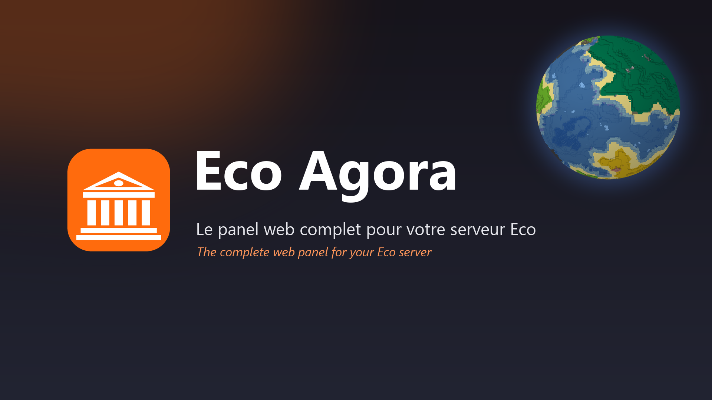
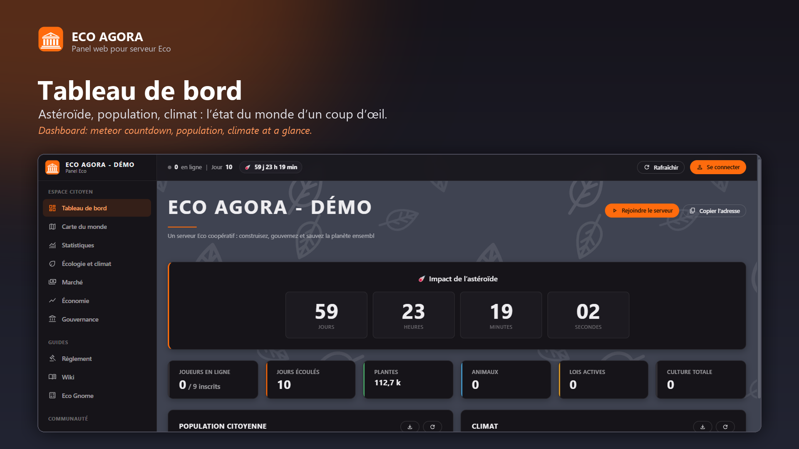
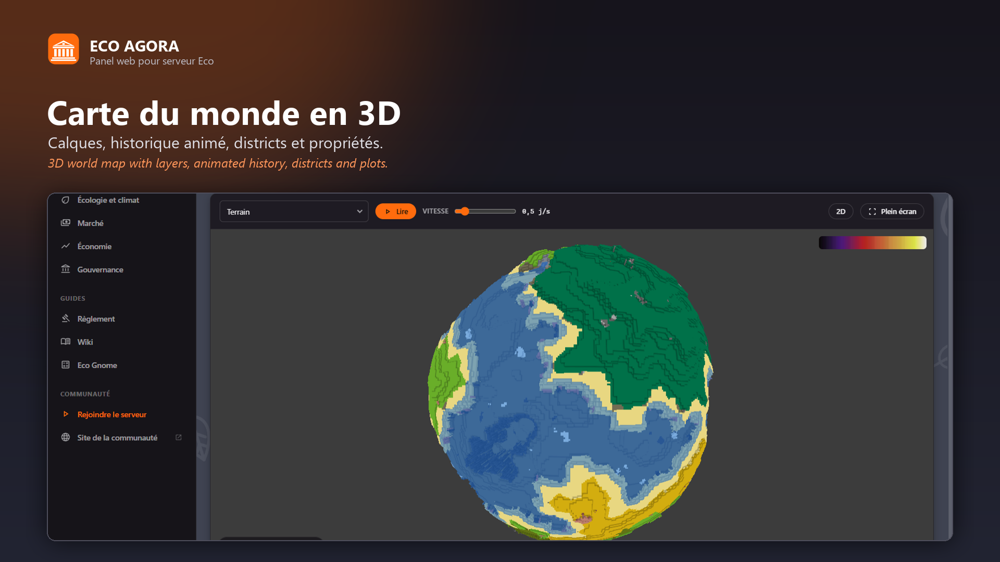
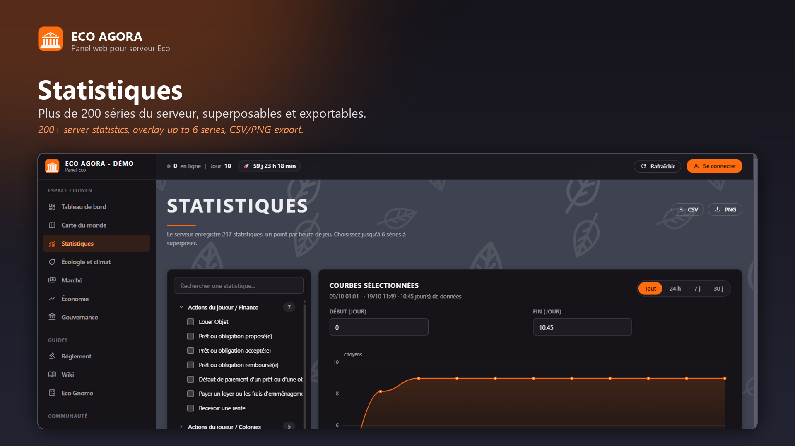
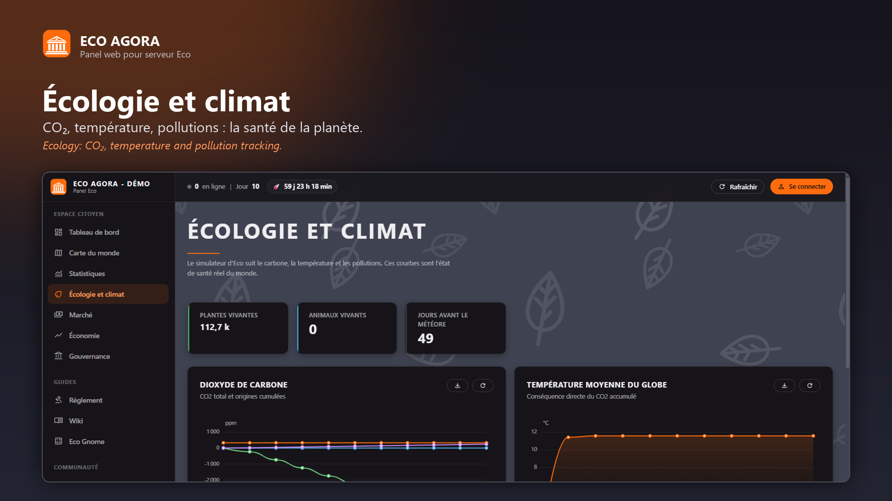
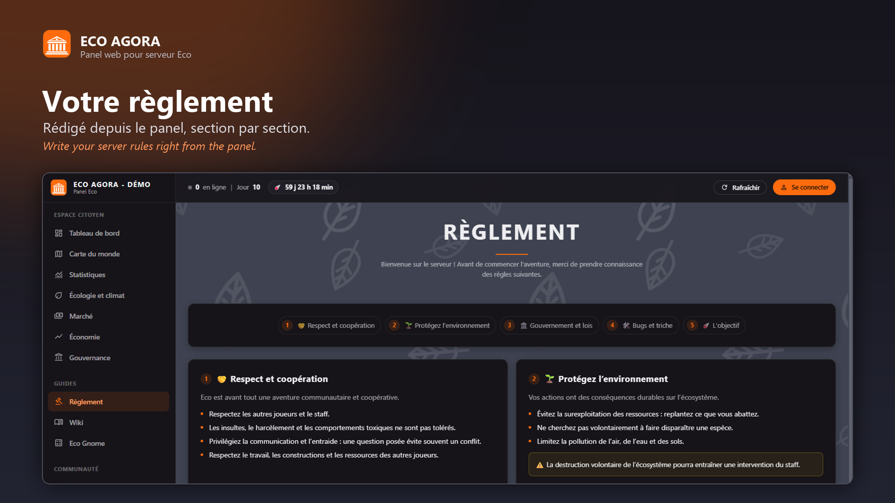
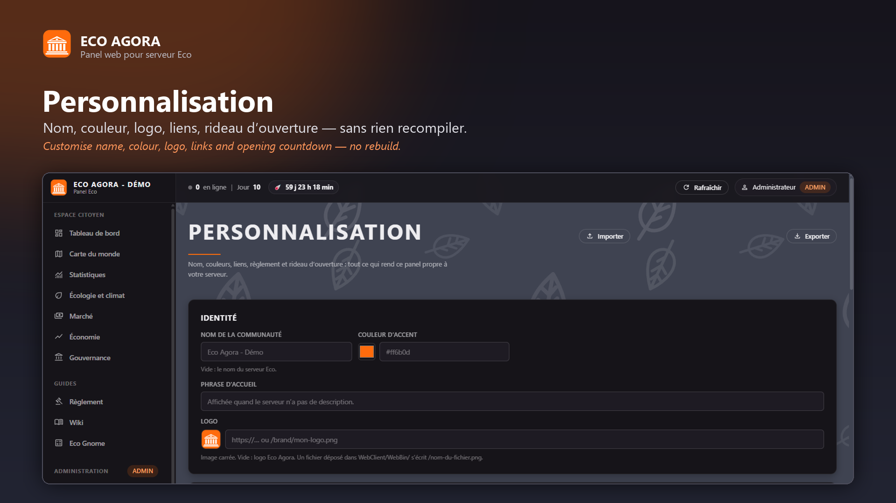
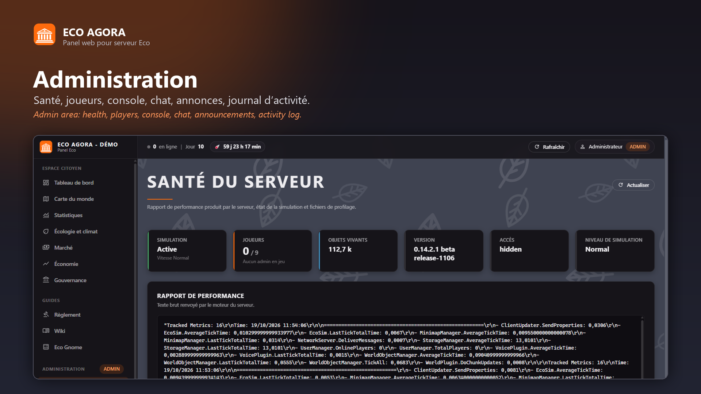

# Eco Agora

**Le panel web complet pour votre serveur Eco.** Eco Agora remplace le site web
de votre serveur Eco (Strange Loop Games) par un panel moderne, en français et en anglais (traduisible),
que vous personnalisez depuis le panel lui-même.

*[English below](#english)* · [Installation](INSTALLATION.md) · [Install guide (EN)](INSTALL.en.md) · [Développement](DEVELOPPEMENT.md)

## Espace citoyen

- **Tableau de bord** : compte à rebours de l'astéroïde, joueurs, population, climat, bouton « Rejoindre le serveur ».
- **Carte du monde en 3D** : calques d'environnement, historique animé, districts et propriétés.
- **Statistiques** : plus de 200 séries du serveur, jusqu'à 6 superposées, export CSV et PNG.
- **Écologie et climat**, **Économie** (avoirs réels des comptes), **Marché**, **Gouvernance** (lois, élections, titres).
- **Règlement**, **Wiki** et **Eco Gnome**, annonces du staff en bandeau.

## Administration

- Santé du serveur, joueurs et modération, console, chat, annonces, exports, configuration.
- **Journal d'activité** des joueurs : qui a fait quoi, où et quand, avec recherche et filtres.
- **Ventes des boutiques** : qui a dépensé combien, dans quelle boutique.
- Connexion depuis le jeu, ou sans lancer le jeu avec la clé d'administration du serveur.

## Personnalisation, sans recompiler

- Nom de la communauté, phrase d'accueil, logo, couleur d'accent.
- Adresse du bouton « Rejoindre » (détectée automatiquement), liens, crédit d'hébergement.
- Éditeur de règlement section par section, langue du wiki, page Eco Gnome.
- **Rideau d'ouverture** : compte à rebours devant le panel jusqu'au jour J, accès anticipé pour les testeurs.
- **Salle d'attente** en jeu (facultative) : avant l'ouverture, les joueurs se connectent mais ne peuvent ni bouger ni agir.

## Langues et compatibilité

- Panel en **français** et en **anglais**, au choix de chaque visiteur. Tous les textes sont dans `WebClient/WebBin/lang/*.json` : corrigez-les ou ajoutez une langue sans recompiler (voir [INSTALLATION.md](INSTALLATION.md#4-langues)).
- Les mods qui ont leurs propres pages continuent de fonctionner ; l'interface d'origine d'Eco reste accessible à `/legacy/` pour ceux qui s'y intègrent.

## Aperçu

| | |
|---|---|
|  |  |
|  |  |
|  |  |

## Installation

1. Téléchargez `eco-agora-1.1.0.zip` dans les [Releases](../../releases).
2. Serveur arrêté, déplacez `WebClient/WebBin/index.html` dans `WebClient/WebBin/legacy/index.html` (l'interface d'origine reste accessible à `/legacy/`).
3. Copiez le contenu de l'archive à la racine du serveur (dossiers `WebClient/` et `Mods/`).
4. Démarrez le serveur, ouvrez son site web, puis *Administration › Personnalisation*.

Guide complet : [INSTALLATION.md](INSTALLATION.md). Compatibilité : Eco 0.14.2.1.
Mod facultatif recommandé : EcoMarketApi (page Marché).

## Licence

Gratuit et à code ouvert, sous **PolyForm Noncommercial 1.0.0**
([LICENSE.md](LICENSE.md)) : utilisez-le, modifiez-le, partagez vos versions,
mais **jamais à des fins commerciales** (ni vente, ni vente d'une version
modifiée). Mentions et exceptions dans [NOTICE.md](NOTICE.md) : le moteur de
carte est adapté du client web d'Eco et reste la propriété de Strange Loop
Games. Eco est un jeu de Strange Loop Games ; Eco Agora est un projet
communautaire indépendant.

Voir aussi : [Location](https://github.com/nicolabcraft/eco-location), un mod
pour louer ses véhicules et bateaux.

---

## English

**Eco Agora** replaces your Eco server's website with a complete, modern panel
in French and English, that you customise from the panel itself.

**Citizen area**: dashboard with meteor countdown, players, population and
climate; 3D world map with environment layers, animated history, districts and
plots; over 200 statistics (up to 6 overlaid, CSV and PNG export); ecology and
climate; economy with real account holdings; market; civics (laws, elections,
titles); rules, wiki and Eco Gnome pages; staff announcements as a banner.

**Administration**: server health, players and moderation, console, chat,
announcements, exports, configuration, a full player activity log (who did
what, where and when) and shop sales (who spent how much, in which shop). Sign
in from the game, or without launching it using the server's admin key.

**Customisation, no rebuild needed**: community name, tagline, logo, accent
colour, join address (detected automatically), links, hosting credit, a section
by section rules editor, wiki language, Eco Gnome page, an opening countdown
curtain with tester access, and an optional in-game waiting room that keeps
players frozen until opening time.

**Languages and compatibility**: French and English, chosen by each visitor;
every text lives in `WebClient/WebBin/lang/*.json`, so you can fix wording or
add a language without rebuilding. Mods with their own pages keep working, and
Eco's original interface stays reachable at `/legacy/`.

**Install**: download `eco-agora-1.1.0.zip` from the [Releases](../../releases),
stop the server, move `WebClient/WebBin/index.html` to `WebClient/WebBin/legacy/index.html`, copy the archive
content to the server root and start it. Full guide:
[INSTALL.en.md](INSTALL.en.md). Compatibility: Eco 0.14.2.1.

**License**: free and source available under **PolyForm Noncommercial 1.0.0**:
use it, modify it, share your versions, but never use it commercially. See
[NOTICE.md](NOTICE.md): the map engine is adapted from Eco's web client and
remains the property of Strange Loop Games. Eco is a game by Strange Loop
Games; Eco Agora is an independent community project.
